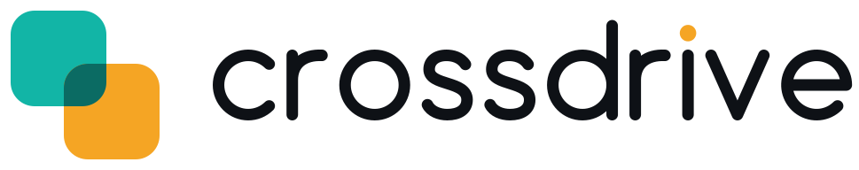

<p align="center">
  <picture>
    <source media="(prefers-color-scheme: dark)" srcset="public/brand/crossdrive-logo-dark.svg">
    
  </picture>
</p>

<p align="center"><strong>Every drive you own. One safe connection for your AI.</strong></p>

<p align="center">
  <a href="https://github.com/vivek-gelp/crossdrive/actions/workflows/ci.yml"></a>
  <a href="LICENSE"></a>
  <a href="https://modelcontextprotocol.io"></a>
</p>

Crossdrive is a self-hosted remote [MCP](https://modelcontextprotocol.io) server that gives Claude (web, desktop, phone),
Claude Code, ChatGPT and any other MCP client one URL onto several Google Drive and Gmail accounts at once. You name
each account with a label you choose, and files are addressed as `work:/Projects/2026` instead of "whichever Google
account this connector happens to be signed into". You run it in your own Vercel project with your own Google OAuth
client, so your tokens and your files never touch anyone else's infrastructure.

It exists because built-in connectors see one Google account, fail silently when they cannot see something, and give
the model destructive tools with the safety rules living only in a prompt. Crossdrive puts the rules in code: trash is
the only delete, mail is draft-only by default, every write is audited, and each account can be read-only.

<!-- DEMO GIF: 20 seconds, phone app, "move the signed contract from my company drive into my personal drive" -->

## What you should know before you connect anything

| | |
|---|---|
| **Scopes requested** | Drive (`drive`) and Gmail (`gmail.modify`, `gmail.compose`, `gmail.send`), per account, from your own Google Cloud project. No scope that permits permanent deletion is requested. |
| **Where tokens live** | Refresh tokens are encrypted with AES-256-GCM and stored in a private Vercel Blob store in your own Vercel account. The key is an environment variable only you hold. |
| **What is logged** | Every completed write: tool, account, affected item, actor. Never file contents, mail bodies or tokens. The log is append-only and readable through the `audit` tool. |
| **Defaults** | No permanent delete (trash only). Mail is draft-only for new accounts. Any account can be switched to read-only on the connect page. A "disconnect everything" button revokes every token and works from a phone. |

## Deploy to Vercel

[](https://vercel.com/new/clone?repository-url=https%3A%2F%2Fgithub.com%2Fvivek-gelp%2Fcrossdrive&env=GOOGLE_CLIENT_ID,GOOGLE_CLIENT_SECRET,CROSSDRIVE_JWT_SECRET,CROSSDRIVE_ENC_KEY,CROSSDRIVE_ALLOWED_EMAILS,CROSSDRIVE_BASE_URL&envDescription=Create%20a%20Google%20OAuth%20client%20and%20two%20random%20secrets%20first&envLink=https%3A%2F%2Fgithub.com%2Fvivek-gelp%2Fcrossdrive%2Fblob%2Fmain%2Fdocs%2Fsetup-vercel.md&project-name=crossdrive&repository-name=crossdrive&stores=%5B%7B%22type%22%3A%22blob%22%7D%5D)

Do the Google Cloud part first ([docs/setup-google.md](docs/setup-google.md)), because the button asks for the client
id and secret. Full walkthrough: [docs/setup-vercel.md](docs/setup-vercel.md).

## Quickstart

1. **Create a Google OAuth client** in your own Google Cloud project, with the Drive and Gmail APIs enabled and the
   consent screen set to Internal (Workspace) or published to Production (personal Gmail).
   [Step by step](docs/setup-google.md).
2. **Deploy to Vercel** with the button above, attach a Blob store, and paste the client id and secret. Generate the two
   secrets with `openssl rand -base64 32` (run it twice). Set `CROSSDRIVE_BASE_URL` to your deployment URL.
3. **Add the redirect URIs** `<your URL>/api/google/callback` and `<your URL>/oauth/google-callback` to the Google
   client, then redeploy. Open `<your URL>/setup` to see a checklist of what is still missing.
4. **Connect your accounts** at `<your URL>/connect`: pick a label (for example `work`, `personal`, `clientco`) and sign
   in with that Google account. New accounts start as read + write with mail as drafts only; switch an account to
   read-only or change its mail mode on its card. Repeat for each account.
5. **Add the connector to your AI client** using `<your URL>/api/mcp` ([details below](#connecting-clients)), then ask:
   "search all my drives for the 2026 lease".

## How it compares

Facts below are drawn from public issue trackers and documentation and were last checked in November 2026. Things move
quickly; please open an issue if a row is out of date.

| | Claude's built-in Drive/Gmail connector | Google's official Drive and Gmail MCP servers | taylorwilsdon/google_workspace_mcp | Crossdrive |
|---|---|---|---|---|
| Several Google accounts under one URL | One account per connector; a request to attach two connectors to the same URL is open with no reply | Not documented as a feature | A documented weak spot: OAuth 2.1 mode binds one identity per session, and a per-account client pull request was closed unmerged in November 2026 | Yes: user-chosen labels, `label:/path` addressing |
| Search across accounts | No | Not documented | Not in OAuth 2.1 mode (one identity per session) | `find` fans out and reports per-account errors and `partial` |
| Cross-account copy of folder trees | Not offered, to our knowledge | Not offered, to our knowledge | Not offered, to our knowledge | Yes, resumable, no file bytes through the server |
| Shared Drive items | Silent empty results in an open issue | The hosted Drive connector omits the same flags, per the same issue | Not assessed here | Supported; unreachable ones return an explicit error |
| Gmail | Label, archive and trash requests are open | Draft only, no send | Send supported; a recipient allowlist is an open proposal | Per account: off, draft or send; draft is the default; optional recipient allowlist |
| Delete | Not assessed here | Not assessed here | Not assessed here | Trash only; no permanent delete tool exists |
| Dynamic client registration | Not applicable | Not supported | Not assessed here | Yes, stateless OAuth 2.1 with PKCE |
| Setup effort | None | Programme enrolment and an OAuth client flagged for AI agents (enforced from 11 November 2026) | Your own Google project plus a local or hosted install | Your own Google project plus a Vercel deploy |
| Breadth of Google products | Drive and Gmail | Drive and Gmail | **Better**: 120+ tools across twelve Google products | Drive and Gmail only, by design |
| Hosting | Anthropic | Google | Local or self-hosted | Self-hosted (Vercel) |

If you need Docs editing, Sheets formulas or Calendar, use google_workspace_mcp, and consider running both. If you
have one Google account and just want to chat with your files, the built-in connector is the least work. Crossdrive is
for people who have several accounts and want an AI to organise across them safely.

## Features

**Several accounts, one URL.** Label each account yourself (`^[a-z][a-z0-9-]{0,23}$`) and connect as many as you like.
Paths are `label:/path` for My Drive, `label:~shared/Folder/...` for folders shared with the account, and
`label:drive/<Shared Drive name>/...` for Shared Drives. Every result carries `owner`, `shared` and `canEdit`.

**Search and organise.** `find` searches every Google account in parallel with timeouts and paging; an account that fails shows
up as an error entry and the response is marked `partial` rather than returning less without saying so. Also `list`,
`tree`, `duplicates` (including across accounts), `changes` (what changed in the last 24 hours or 7 days) and `inbox`.

**Move things between accounts.** `copy` copies files and whole folder trees between accounts using Drive's server-side
copy, in resumable slices. `batch` applies up to 100 moves, renames, trashes and copies with a dry-run preview and a
single batch id. `undo` reverses a move, rename, trash or untrash using the audit log.

**Gmail.** Search, read (bodies as plain text, never raw HTML), label, archive, trash, draft, reply, and save attachments
straight into Drive. Sending is off by default and can be limited to an allowlist of recipients.

**Large files.** `upload_begin` returns a pre-authorised Drive upload URL so the bytes go from your computer straight to
Google. `scripts/bulk-upload.mjs` mirrors a local folder into a drive with skip-if-exists and resume.

**Control from a phone.** The connect page lets you flip an account between read-only and write, reconnect it, disconnect
it (which revokes the token at Google) or disconnect everything, from any browser.

**Per-client consent.** Each MCP client that connects sees a consent screen naming the client and its redirect host, and
can be downgraded to read-only. This is the MCP specification's answer to the confused-deputy problem.

**BETA: OneDrive and Dropbox.** Microsoft Graph and Dropbox accounts can sit under the same labels. `transfer` copies or
moves files and folder trees between any two accounts across providers, resumable and verified by size or hash, with the
source trashed only after verification. **This part has not yet been tested against live Microsoft or Dropbox accounts;
it is tested against in-memory fakes of their APIs only.** Treat it as beta, run it on copies first and read
[docs/providers.md](docs/providers.md).

## Tools

44 tools. Full reference with arguments: [docs/tools.md](docs/tools.md). Most write tools accept `dryRun`; tools.md lists
which do not. The Drive, Gmail and sharing tools work on Google accounts; the `cloud_*` tools and `transfer` are BETA,
not yet tested against live OneDrive or Dropbox accounts.

| Tool | Access | What it does |
|---|---|---|
| `accounts` | read | Connected accounts with provider, email, storage (Google), mode and mail mode |
| `status` | read | Token health per account: whether the refresh token still works, granted scopes, mode, mail mode |
| `drives` | read | Shared Drives an account belongs to, with their `label:drive/<name>` paths |
| `find` | read | Search all Google accounts or one; per-account errors, `partial`, timeouts, paging |
| `list` | read | One level of a folder |
| `tree` | read | A folder tree to a given depth with counts and sizes |
| `shared` | read | Items other people have shared with an account |
| `read` | read | File content as text, wrapped as untrusted data |
| `inbox` | read | Loose files in the root and in the configured inbox folder |
| `permissions` | read | Who has access to a file |
| `duplicates` | read | Duplicate groups within or across accounts, with a suggested keeper |
| `changes` | read | Files modified since a time, across accounts |
| `audit` | read | Recent write-log entries |
| `mkdir` | write | Create a folder (idempotent) |
| `put` | write | Upload small content, or stream a web file into Drive |
| `upload_begin`, `upload_finish` | write | Pre-authorised large upload from the client's machine |
| `move`, `rename` | write | Move or rename within an account |
| `trash`, `untrash` | write | Trash is the only delete |
| `undo` | write | Reverse a move, rename, trash or untrash from the audit log |
| `copy` | write | Copy files or folder trees, within or across accounts, resumable |
| `batch` | write | Up to 100 operations with dry-run and one batch id |
| `share`, `unshare`, `transfer_ownership` | write | Sharing changes, each audited with email and role |
| `shortcut` | write | Create a Drive shortcut |
| `mail_search`, `mail_read`, `mail_labels`, `mail_attachment` | read | Gmail search, read, label list, attachment text |
| `mail_draft` | write | Create a draft; nothing is sent |
| `mail_send`, `mail_reply` | write | Send or reply; only for accounts whose mail mode is `send` |
| `mail_label` | write | Label, archive, trash, mark read; no permanent delete |
| `transfer` (beta) | write | Copy or move files and trees between any two accounts, across providers |
| `cloud_list`, `cloud_find`, `cloud_read` (beta) | read | List, search and read on OneDrive and Dropbox accounts |
| `cloud_mkdir`, `cloud_move`, `cloud_rename`, `cloud_trash` (beta) | write | Write operations on OneDrive and Dropbox accounts |

## Safety model

Safety is enforced by the server, not requested of the model. Annotations such as `readOnlyHint` are set honestly but
are never relied on.

- **No permanent delete.** No tool exists for it and no Gmail scope that allows it is requested. Trash is recoverable.
- **Read-only accounts** cannot reach a write tool at all: the tool is refused in code before Google is called.
- **Mail modes** per account: `off`, `draft` or `send`. New accounts start at `draft`. Send can be restricted with
  `CROSSDRIVE_MAIL_ALLOWED_RECIPIENTS`. The sender is never inferred.
- **Untrusted content.** File and mail content is returned wrapped and labelled as data, URLs found inside documents are
  never fetched, and no forwarding filters can be created.
- **Dry run and undo.** Most write tools accept `dryRun` ([which ones](docs/tools.md)); `batch` and `transfer` preview by
  default; `undo` reverses moves, renames, trashes and untrashes.
- **Audit.** Append-only, actions only, never bodies or tokens.
- **Revocation.** Disconnect an account (token revoked at Google or Dropbox; Microsoft offers no per-token revoke) or
  everything, from the connect page.
- **Tokens.** Encrypted at rest; read-only static tokens for scripts; OAuth artefacts are signed JWTs, so rotating
  `CROSSDRIVE_JWT_SECRET` invalidates every issued token.

The threat model and what is deliberately not built: [docs/security.md](docs/security.md).

## About the Google "unverified app" screen

Because you create the OAuth client in your own Google Cloud project, Google treats it as your own app.

- **Google Workspace users:** set the OAuth consent screen user type to **Internal**. Members of your organisation never
  see a warning. Workspace admins can still block third-party apps, in which case see the troubleshooting section of the
  setup guide.
- **Personal Gmail users:** the consent screen type has to be **External**. You will see "Google hasn't verified this
  app" once per account, for your own app. Click **Advanced**, then **Go to (your app name) (unsafe)**. Nothing is wrong;
  you are the developer.
- **Publish to Production.** While an External app is in Testing mode Google expires its refresh tokens after 7 days, so
  your connections would silently die weekly. Publishing to Production removes that. You do not need to submit for
  verification for your own use.
- **Why there is no shared, verified Crossdrive client yet.** Drive and Gmail are restricted scopes. A public app using
  them needs Google's verification and an annual third-party security assessment (CASA), and until then is capped at 100
  users. Self-hosting avoids all of that and keeps your tokens in your own account. A verified hosted option is on the
  roadmap; the groundwork is in [docs/google-verification/](docs/google-verification/README.md).

## Connecting clients

Your MCP endpoint is `<your URL>/api/mcp`.

- **Claude on the web, desktop and phone:** Settings, Connectors, Add custom connector, paste the URL. Claude discovers
  the OAuth server, shows you Crossdrive's consent screen and signs you in with an allowed email. Add the connector on
  the web or desktop app; it is then available in the phone app.
- **Claude Code:**

  ```bash
  claude mcp add --transport http crossdrive https://YOUR-DEPLOYMENT.vercel.app/api/mcp
  ```

  then run `/mcp` inside Claude Code to finish the browser login.
- **ChatGPT:** add a custom MCP connector (developer mode) with the same URL and OAuth. Connector availability depends
  on your ChatGPT plan.
- **Other clients:** send `Authorization: Bearer <token>` with a value from `CROSSDRIVE_STATIC_TOKENS` (full access) or
  `CROSSDRIVE_READONLY_TOKENS` (read tools only). For stdio-only clients use `mcp-remote`:

  ```json
  {
    "crossdrive": {
      "command": "npx",
      "args": ["-y", "mcp-remote", "https://YOUR-DEPLOYMENT.vercel.app/api/mcp", "--header", "Authorization: Bearer ${CROSSDRIVE_TOKEN}"]
    }
  }
  ```

## Configuration

Copy `.env.example`. The legacy `VAULT_` prefix is still accepted for every `CROSSDRIVE_` variable.

| Variable | Purpose |
|---|---|
| `GOOGLE_CLIENT_ID`, `GOOGLE_CLIENT_SECRET` | Your Google OAuth client |
| `CROSSDRIVE_JWT_SECRET` | Signs OAuth artefacts; rotating it revokes every issued token |
| `CROSSDRIVE_ENC_KEY` | 32 random bytes, base64; encrypts stored refresh tokens |
| `CROSSDRIVE_ALLOWED_EMAILS` | Comma-separated emails allowed to sign in and administer |
| `CROSSDRIVE_BASE_URL` | Public URL of the deployment |
| `CROSSDRIVE_STATIC_TOKENS`, `CROSSDRIVE_READONLY_TOKENS` | Optional bearer tokens for scripts and other clients |
| `CROSSDRIVE_MAIL_ALLOWED_RECIPIENTS` | Optional allowlist of recipients for `mail_send` and `mail_reply` |
| `CROSSDRIVE_NAMING_RULE` | `date-entity` enforces `YYYY-MM-DD_Company_WhatItIs.ext` on uploads and renames; default off |
| `CROSSDRIVE_INBOX_FOLDER` | Name of the inbox folder `put` defaults to and `inbox` reports |
| `CROSSDRIVE_OPERATOR`, `CROSSDRIVE_CONTACT` | Name and contact shown on the privacy and terms pages |
| `MS_CLIENT_ID`, `MS_CLIENT_SECRET`, `MS_TENANT` | OneDrive (BETA, not yet tested against live accounts); `MS_TENANT` is optional, default `common` |
| `DROPBOX_CLIENT_ID`, `DROPBOX_CLIENT_SECRET` | Dropbox (BETA, not yet tested against live accounts) |
| `BLOB_READ_WRITE_TOKEN` | Set by the Vercel Blob store |

## Limits and non-goals

- Drive and Gmail only on Google. No Docs editing, Sheets formulas, Calendar or Chat; use another server for those.
- One owner per deployment. It is not a multi-tenant hosted service.
- Folder copy runs in slices (the client follows a resume cursor) because serverless requests are time-limited.
- `put` with inline content is for small files because Vercel limits request bodies to about 4.5 MB; use
  `upload_begin` or `sourceUrl` for anything bigger.
- Scanned PDFs without a text layer are not read; there is no OCR and none is planned.
- Never built: permanent delete, forwarding filters, fetching URLs found inside documents.
- OneDrive and Dropbox support is BETA and not yet tested against live accounts.
- Crossdrive is not a backup tool or a bulk migration service; rclone and similar tools are better at that.

## Roadmap

Not promises, in rough order of interest:

- A rules engine on the changes feed ("anything landing in the inbox that matches X goes to Y with name Z").
- Local stdio and Docker mode for people who do not want remote hosting.
- Folder-scoped tokens (a token confined to one subtree).
- A verified hosted option, if there is demand and the verification work is worth it.
- Promote OneDrive and Dropbox out of beta once they have been tested against live accounts.
- OCR is not planned.

## Contributing

Issues and pull requests are welcome. Read [CONTRIBUTING.md](CONTRIBUTING.md) first; [CLAUDE.md](CLAUDE.md) describes the
architecture and the invariants a change must not break. Report security problems privately as described in
[SECURITY.md](SECURITY.md). Release notes: [docs/CHANGELOG.md](docs/CHANGELOG.md).

## Licence

[MIT](LICENSE), copyright Crossdrive contributors.
